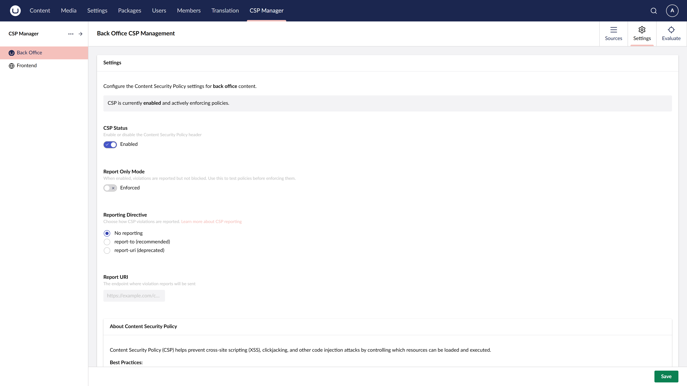

# Policy Settings

Each policy (frontend, backoffice, or domain-specific) has settings that control how the CSP header is sent.

{: width="3840" height="2160" }

## Enabled

Toggles whether the CSP header is sent for this policy. When disabled on a global policy, no header is added. When disabled on a domain policy, requests fall back to the Frontend policy or send no header (see [DisabledNodePolicyBehavior](../features/configuration#disablednodepolicybehavior)).

## Report Only

When enabled, the policy is sent as `Content-Security-Policy-Report-Only` instead of `Content-Security-Policy`. The browser reports violations (to the configured Report URI) but does not block any resources.

This is useful for:
- Testing a new policy before enforcing it
- Monitoring violations in production without breaking the site
- Diagnosing issues when resources are unexpectedly blocked

## Reporting Directive

Selects how violations are reported: **No reporting**, `report-to` (modern, requires a Reporting API endpoint) or `report-uri` (legacy, widely supported).

## Report URI

Shown when a reporting directive is selected. For `report-uri`, enter an absolute HTTP/HTTPS URL or relative path. For `report-to`, enter the endpoint name defined in your `Reporting-Endpoints` header (such as `csp-endpoint`).

Leave blank if you do not want to collect violation reports.

## Value validation

Source values, directives, and Report URIs are written directly into the HTTP response header. To prevent header injection or malformed responses, CSP Manager validates values on save:

- Values cannot contain whitespace, semicolons (`;`), commas (`,`), or control characters (such as newlines).
- Directives must match recognized CSP directive names.
- Report URIs must be valid URIs (for `report-uri`) or endpoint names (for `report-to`).

Validation applies across the backoffice, [uSync](../integrations/usync) imports, and the `ICspService` API. Invalid values are rejected with a descriptive error.

## Upgrade Insecure Requests

When enabled, adds the `upgrade-insecure-requests` directive to the CSP header. This instructs browsers to automatically rewrite HTTP resource URLs to HTTPS before fetching them.

This is most useful when:
- Migrating a site from HTTP to HTTPS and legacy content still references HTTP URLs
- You want to enforce HTTPS loading of all resources without updating every URL manually

Note that `upgrade-insecure-requests` does not affect cross-origin requests — it only applies to same-origin and navigational requests for the current document's origin.
