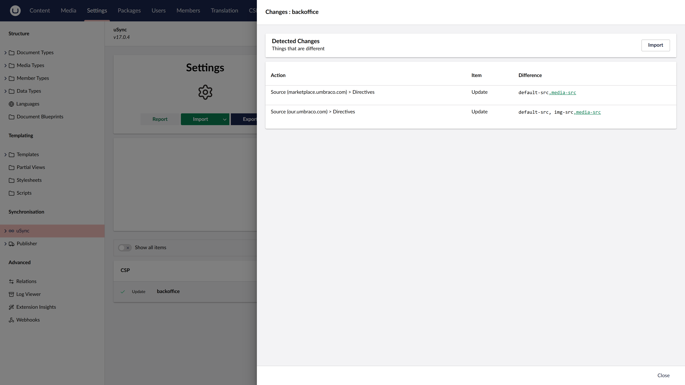

# uSync Integration

[Umbraco.Community.CSPManager.uSync](https://www.nuget.org/packages/Umbraco.Community.CSPManager.uSync/) adds support for synchronizing CSP policies across Umbraco environments using [uSync](https://github.com/KevinJump/uSync).

Once installed, uSync automatically includes your CSP definitions in its export/import cycle — syncing CSP configurations alongside your other Umbraco settings.

{: width="3840" height="2160" }

## Requirements

- Umbraco 18+
- [Umbraco.Community.CSPManager](https://www.nuget.org/packages/Umbraco.Community.CSPManager/) 17+
- [uSync.BackOffice](https://www.nuget.org/packages/uSync.BackOffice/) 17+

## Installation

```bash
dotnet add package Umbraco.Community.CSPManager.uSync
```

Or via the Package Manager Console:

```powershell
Install-Package Umbraco.Community.CSPManager.uSync
```

No further configuration is needed. After installation, CSP definitions appear in the uSync export/import cycle automatically.

## How It Works

The package registers a uSync serializer for `CspDefinition` objects. When uSync exports or imports settings, it includes the frontend and backoffice CSP policies. This means you can:

- Export CSP policies from one environment and import them into another via the uSync backoffice UI
- Include CSP policies in version-controlled uSync XML files
- Deploy CSP policy changes alongside code using your normal deployment pipeline

## Domain policies

[Domain policies](../features/domain-policies) have their own handler, **CSP Node Policies**, in the uSync **Content** group. A policy belongs to a content node, and uSync imports content and Culture and Hostnames in the Content group, so the policy imports after its node and hostnames. The Frontend and Backoffice policies stay in the **Settings** group.

Each policy is exported as `CspNodePolicies/node-{contentKey}.config`, where `contentKey` is the key of the content node the policy belongs to. uSync keeps content keys the same on every environment, so a policy lines up even when the node's hostnames differ per environment. The file's key is made from the content key too, so a policy for the same node gets the same file on every environment, even when each environment created its own. Deleting a domain policy writes a delete marker so the removal syncs on the next import.

| Import condition | Outcome |
|---|---|
| Policy does not exist on target | Created. |
| Target already has a policy for that content node | Existing policy is updated. |
| Content node does not exist on target, or has no hostname | Import fails with an error. Import the content and its Culture and Hostnames first (a full import, or the Content group, does this in the right order). |
| Policy contains invalid values (e.g. `;`, `,`, newlines, unknown directives) | Import fails with validation errors. |

{: .note }
A Settings-only import (for example `ImportAtStartup: Settings`) imports the Frontend and Backoffice policies but not domain policies. Import the Content group too to bring them in.

{: .note }
Domain policies belong to a content node, not to a hostname. On each environment they apply to whatever hostnames that node has in Culture and Hostnames, so local, staging and production hostnames can differ.

